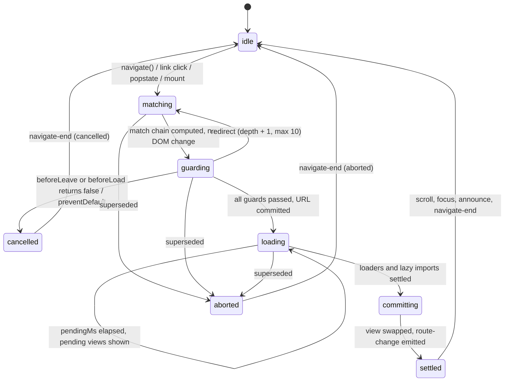

# RFC 0001: Navigation lifecycle

- **Status**: Draft
- **Date**: 2026-10-10
- **Tracking**: bead `meow-7nu.5`, plan [`plans/005-rfc-navigation-lifecycle.md`](../../plans/005-rfc-navigation-lifecycle.md)
- **Unblocks**: `meow-7nu.6` (accessibility), `meow-7nu.7` (typed search), `meow-7nu.8` (ranked matching)

## Summary

meowter currently _matches_ URLs. It does not _navigate_. `navigate()` pushes a history entry, flushes the signal graph and shows or hides `<meow-route>` elements, all synchronously, and nobody can veto, delay or fail it. This RFC adds a **navigation transaction** that runs the same way for every route-definition style (HTML, code, file routes):

1. Match the target URL without touching the DOM.
2. Run guards, which can cancel or redirect.
3. Commit the URL.
4. Run loaders and lazy imports in parallel, with an `AbortSignal`, showing pending UI after a delay.
5. Swap the view, then restore scroll, move focus and announce the new page.

`navigate()` returns a `Promise<NavigationResult>` that never rejects. Navigations with no async work keep today's synchronous behaviour, so existing apps don't change. Ranked matching and Standard-Schema-typed search params are specified here so they plug into the same transaction.

## Goals / Non-goals

### Goals

- One transaction model shared by `<meow-router>` (HTML), `createRouter()` (code) and `createFileRoute()` (file routes).
- Guards (`beforeLoad`) that can cancel or redirect, written as async functions with an `AbortSignal`.
- Per-route loaders that run in parallel and pass data to `render` as an accessor, with pending and error states that avoid flashing.
- Lazy route UI code (`lazy: () => import(...)`), while guards and loaders stay eager.
- A navigation that starts while another is running aborts the first one, and the first one's result says it was aborted.
- Accessible by default: scroll restoration per history entry, focus management, a live-region announcement, and View Transitions as an opt-in.
- Events that are complete enough for the Lit DevTools timeline to draw navigations as spans rather than points.
- Framework-free: everything is reachable from plain DOM (events and element properties).
- Keep the synchronous fast path, so routes without guards, loaders or lazy code behave exactly as they do today.

### Non-goals

- **SSR / streaming.** meowter is a client-side custom-element router. SSR would need a server renderer for custom elements and a data-hydration protocol. Nothing here blocks adding it later, because loaders are plain async functions of `{ params, search, signal }`.
- **Data caching** (stale-while-revalidate, `staleTime`, `gcTime`). Loaders re-run when you enter a route. Apps can cache inside their loaders. See Open questions.
- **Preloading on hover / intent.** Left for later; the transaction shape allows it (`cause: "preload"`).
- **Form actions / mutations.** Solid 2's `action()` already covers this at the app layer.
- **Cross-document navigation.** Only same-document navigations are intercepted.

## Background

All facts below are taken from the working tree after plans 001–004 landed. Paths are relative to `packages/meowter/src/`.

### Navigation is synchronous and cannot be vetoed

- `MeowRouter.navigate(href, state?): void` (`router-element.ts`, `navigate`) does the following in order:
  1. Prefixes the basepath (`#prependBasepath`).
  2. If the path, search or hash changed, calls `history.pushState({ __meowterHistoryId, user })` and appends to the in-memory history store, cutting off any forward entries.
  3. Sets the URL and state signals.
  4. Calls `flush()`.
  5. Dispatches `route-change`.
- An unchanged URL skips `pushState` but still sets the signals, flushes and emits.
- `replace()` is the same except that it uses `replaceState` and **always allocates a new history id**.
- The code-defined `Router.navigate()/replace()` (`create-route.ts`) are overloaded wrappers that return `void` and silently do nothing before `mount()`.
- `popstate` (`router-element.ts`, `#onPopState`) runs after the browser has already changed the URL. It re-syncs the signals, flushes and emits `route-change`. It has no hook and cannot be vetoed.
- Clicks on same-origin `<a>` elements are captured by `<meow-router>` (`link-intercept.ts`, `shouldInterceptLinkClick`) and turned into `navigate(url.href)`.
- Only the History API is used. There is no Navigation API code.

### Event order today

`route-leave`/`route-match` (`route-element.ts`, `deactivate`/`activate`) fire **inside** `flush()`, from the outlet's selection effect (`outlet-element.ts`). For each outlet, leaves fire before matches. `route-change` (target `<meow-router>`, detail `{ url, state }`) fires **last**. All three events bubble, are composed and are **not cancelable**. Every `url` in them is the raw URL including the basepath. By the time any of them fires, `window.location` and the DOM are already updated, so there is no pre-commit signal. The Lit example (`examples/lit-kitchensink/src/routing-timeline.ts`) draws all three as point events on a "Routing" lane.

### Matching is first-match in DOM order

- `selectFor()` (`path-select.ts`) walks an outlet's direct `<meow-route>` children in DOM order:
  - `*` is remembered as a fallback.
  - An index route matches only `/`.
  - The first exact regex match wins.
  - Failing that, routes that contain a nested `<meow-outlet>` may match a prefix.
- Nested outlets derive their input from the parent outlet's `remainder` (`outlet-element.ts`).
- There is no specificity ranking at runtime. Only the file-routes codegen sorts by specificity before emitting (`codegen/extract-file-routes.ts`, 176–195), so `/cats/new` beats `/cats/:id` for file routes but not for HTML or code trees where `:id` comes first.
- Params are decoded with `safeDecode` (`path-compile.ts`): malformed percent-encoding passes through raw instead of throwing (plan 002).

### Rendering is synchronous and now scoped

- `wireRender` (`create-route.ts`) calls `render(ctx)` on `route-match` with `ctx = { params, matched, route, router }`. Since plan 004, the call runs inside a `createRoot` that is disposed on `route-leave`.
- `RouteRenderResult` is `Node | DocumentFragment | string | null | void`.
- There is no async support, no lazy import and no error handling: a throw inside `render` propagates out of the event listener.
- File routes bind `render` through `bindFileRoute()` (`file-routes.ts`), so they share `wireRender`.

### Search params and history

- `router.searchParams` is a derived store `Record<string, string[]>` keyed off the URL signal. `setSearchParam(key, value, { history })` navigates or replaces (default `replace`). It has no types and no validation.
- The history store (`events.ts`: `HistoryEntry { id, href, state }`) is in-memory and per instance. Ids come from a counter that starts at 0 on each page load, while ids that survived in `history.state` are re-used, so ids **can collide after a reload**. `replace()` also changes the id. Both must be fixed before ids can key scroll positions.

### Solid 2 primitives available

`@solidjs/signals` 2.0.0-rc.0 exports `createMemo` (it may return a Promise; unresolved reads throw `NotReadyError`), `isPending`, `latest`, `refresh`, `resolve`, `action`, `createOptimistic`, `createLoadingBoundary`, `createErrorBoundary`, `onSettled`, `createRoot` and `runWithOwner`. It does **not** export `createAsync`, `isRefreshing` (documented in `docs/solid-2.0/05-async-data.md` but missing from the RC), or a public transition API. Transitions are implicit.

### Nothing else exists yet

A grep for guard, loader, lazy, scroll, focus, `aria-live` and `startViewTransition` finds nothing in `src/` outside tests.

### Corrections to the plan's "Current state"

The plan understated three things:

- The event ordering: `route-change` fires after `route-match`/`route-leave`, not before.
- The history-id collision and `replace()` re-keying.
- The basepath split: `matchURL()` (basepath stripped) is used for matching and link state, while event URLs are raw.

Everything else held.

## Prior art

### TanStack Router

Source: <https://tanstack.com/router/latest/docs/framework/react/guide/data-loading>

- `beforeLoad(opts)` runs parent to child, before any loader. Its options include `params`, `search`, `location`, `abortController` and `cause: "preload" | "enter" | "stay"`, and its return value is merged into the route context. **Borrow**: a separate guard phase that runs in order and before loaders, plus `cause`.
- `loader({ params, deps, context, abortController, cause })` runs in parallel across matched routes. `loaderDeps` controls which search params trigger a reload. **Borrow**: loaders do not re-run on unrelated search changes.
- `redirect({ to })` and `notFound()` work whether thrown or returned, from both guards and loaders (<https://tanstack.com/router/latest/docs/framework/react/api/router/redirectFunction>). **Borrow** the redirect value.
- `pendingComponent` with `pendingMs` (1000) and `pendingMinMs` (500) prevents flashes, and `errorComponent({ error, reset })` handles failures. **Borrow** both timers.
- `validateSearch` accepts any Standard Schema directly (<https://tanstack.com/router/latest/docs/framework/react/guide/search-params>).
- Lazy routes split only UI: guards and loaders stay in the critical, preloadable chunk (<https://tanstack.com/router/latest/docs/framework/react/guide/code-splitting>). **Borrow**.
- `router.navigate()` returns `Promise<void>`. **Avoid**: callers can't tell success from a redirect or a cancel.

### React Router (data APIs)

Source: <https://reactrouter.com/start/data/route-object>

- `loader({ params, request })`, where `request.signal` aborts on interruption.
- Redirects are `throw redirect("/login")`.
- `useNavigation().state` is `"idle" | "loading" | "submitting"`. **Borrow** a single global pending signal (`router.pending`).
- Loaders revalidate on every search-param change unless `shouldRevalidate` says otherwise. **Avoid** that default and prefer TanStack's `loaderDeps`.

### Vaadin Router

Source: <https://github.com/vaadin/router>

- **No longer maintained.** Its README points users to `@lit-labs/router`. Treat it as prior art only.
- Component hooks are `onBeforeEnter(location, commands)`, which can return `commands.redirect(path)` or `commands.prevent()`, `onBeforeLeave` (useful for dirty-form guards) and `onAfterEnter`/`onAfterLeave`. The router awaits promises they return.
- A route `action(context, commands)` can resolve a component, redirect or prevent, and is the documented place for `await import()`.
- **Borrow**: leave guards and "guards return a decision". **Avoid**: guards that live only on component instances. A guard has to run before the component exists.

### @lit-labs/router

Source: <https://github.com/lit/lit/blob/main/packages/labs/router/README.md>

- `new Routes(host, [{ path, enter?, render }])` is a reactive controller. Routes match in array order, using URLPattern.
- `enter(params)` may be async. Returning `false` rejects the match, and matching continues with the next route.
- `goto()` returns a Promise that resolves once `enter` callbacks finish. Lazy loading means `await import()` inside `enter`.
- It is still Labs, and its README warns of breaking changes. It has no redirect, abort, pending or error model.
- **Borrow**: async enter and an awaitable `goto`. **Avoid**: "false means try the next route", which makes matching depend on side effects.

### Navigation API

Sources: <https://developer.mozilla.org/en-US/docs/Web/API/Navigation_API>, <https://developer.chrome.com/docs/web-platform/navigation-api>, <https://caniuse.com/mdn-api_navigation>

- Support: **Baseline 2026, "newly available"**. Chrome/Edge 102+, Firefox 147+ and Safari 26.2+, about 91% of global usage according to caniuse (checked 2026-10-10). Older Safari and Firefox still need a History API fallback.
- `navigation.addEventListener("navigate", (e) => e.intercept({ handler, precommitHandler, focusReset, scroll }))` sees every same-document navigation: links, forms, `back()`, and programmatic calls. No click capture is needed.
- `e.signal` aborts when a newer navigation supersedes this one or the user presses stop. `navigation.navigate()` returns `{ committed, finished }`. `navigation.transition` exposes the navigation that is in flight.
- `precommitHandler` defers the URL commit, which is the natural home for guards and redirects. `focusReset` and `scroll` default to running after the transition.
- `navigation.entries()` and `currentEntry.key` give stable per-entry keys, which suit scroll restoration.
- No `navigate` event fires on initial load, and cancelling back/forward is limited.
- **Borrow** the state model (signal, commit point, finished) for meowter's internal design, so a Navigation API driver can drop in later.

### View Transitions

Sources: <https://developer.mozilla.org/en-US/docs/Web/API/Document/startViewTransition>, <https://caniuse.com/mdn-api_document_startviewtransition>

- `document.startViewTransition(update)` or `startViewTransition({ update, types })` snapshots the old DOM, runs `update` (which may be async) and animates to the new DOM.
- Same-document support is Baseline 2025: Chrome/Edge 111+, Firefox 144+ and Safari 18+.
- **Borrow**: wrap only the view-commit step, once data is ready, so the transition never animates to a pending state. Pass direction `types` (`forward`/`back`/`replace`) and feature-detect.

## The navigation transaction

Every navigation, whether from `navigate()`/`replace()`, an intercepted link, `popstate`, `setSearchParam()` or the initial mount, runs one transaction. A transaction has an id, a `cause` (`"push" | "replace" | "traverse" | "initial"`), a `from` URL, a `to` URL and an `AbortController`.



### Phases

1. **matching**
   - The router computes the **match chain** (root → leaf `<meow-route>`s) for `to` with a pure function. It reuses `selectFor()` over the route elements, the same algorithm the outlets use, but writes no signals.
   - Search params are validated here (see Typed search params), so guards receive typed values.
   - Outlets keep rendering the **committed** URL throughout.
2. **guarding**
   - `navigate-start` is dispatched synchronously on `<meow-router>`. It is cancelable, and listeners can `preventDefault()`, call `redirect()` or call `waitUntil(promise)`.
   - Then `beforeLeave` runs on each route being _left_, deepest first. Returning `false` cancels the navigation (typically a dirty form).
   - Then each route's `beforeLoad` runs **sequentially, parent first**, for routes that are being _entered_. Routes that stay matched with unchanged params don't re-run.
   - A guard can return `false` to cancel, or return or throw `redirect({ to })`. A redirect restarts at **matching** with `cause: "replace"`, up to 10 times. After that the navigation fails with a `RedirectLoopError`.
3. **URL commit** (the edge from guarding to loading)
   - `pushState`/`replaceState` runs and the history store is updated.
   - From now on `currentURL()` is the new URL, but outlets select from a separate **view URL** signal that has not moved yet, so the old view stays on screen.
   - `router.pending()` becomes `true` and `<meow-router>` gets the `data-pending` attribute.
4. **loading**
   - Every entered route's `loader` and `lazy` import runs **in parallel**, all sharing the transaction's `signal`.
   - Routes that stay matched re-run their loader only if their params changed, or if their `loaderDeps(search)` result changed (compared shallowly).
   - If loading outlasts `pendingMs` (default 300), the view commits early to the pending state: the deepest route whose loader is still pending renders its `pending` view, and its ancestors render normally. That pending view then stays at least `pendingMinMs` (default 300).
   - A loader that throws leaves the error on that route; it does not cancel its siblings.
5. **committing**
   - The view URL signal is set and `flush()` runs. Outlets select, `route-leave`/`route-match` fire as they do today, and `render(ctx)` runs with `ctx.data` already resolved.
   - If `viewTransition` is enabled, this step runs inside `document.startViewTransition({ update, types })`.
   - `route-change` is then dispatched, with the same timing guarantee as today: after the DOM is updated.
6. **settled**
   - Scroll is restored or reset, focus moves and the change is announced (see Accessibility & UX).
   - `navigate-end` is dispatched and the `navigate()` promise resolves.

### Interruption

- Starting a transaction aborts the one in flight: `controller.abort(new DOMException("superseded", "AbortError"))`.
- The aborted transaction stops at its next await point, dispatches `navigate-end` with `status: "aborted"` and resolves its promise with `{ status: "aborted" }`.
- If the aborted transaction had already committed the URL, the new transaction treats that URL as `from`. No history entry is rolled back, because the browser's history already holds it, and that matches what the user sees in the address bar.

### Back/forward (`popstate`)

- When `popstate` fires, the URL has **already** changed, so the transaction starts at matching with `cause: "traverse"` and `committed: true`. Guards still run.
- If a guard cancels a traversal, the router restores the previous entry with `history.go(-delta)`. It computes `delta` from the history store's entry index, so the store's ids must be stable (fixed in Phase 2). It ignores the `popstate` that this restore causes.
- If a guard redirects during a traversal, the router replaces the current entry.
- This is best effort and documented as such: the user sees a brief URL flicker. The Navigation API has the same limitation for traversals.

### Fast path (compatibility)

- If no route in the target chain has `beforeLoad`, `loader`, `lazy` or an async `validateSearch`, and no `navigate-start` listener called `waitUntil`, the whole transaction runs **synchronously** inside `navigate()`.
- The URL and view commit together, and `route-change` fires before `navigate()` returns, as today.
- The returned promise is already resolved. Every existing app and test keeps its current behaviour.

## API proposal

### Shared types

```ts
type NavigationCause = "push" | "replace" | "traverse" | "initial";

interface NavigationResult {
  /** "success" includes redirected navigations; check `redirectedFrom`. */
  status: "success" | "cancelled" | "aborted" | "error";
  /** Final URL (after redirects); for cancelled/aborted, the URL now in the address bar. */
  url: URL;
  redirectedFrom?: URL;
  error?: unknown;
}

interface Redirect {
  readonly __meowRedirect: true;
  to: string | NavigateRouteOptions<AnyRoute>;
  replace?: boolean; // default true when redirecting
}

declare function redirect(to: Redirect["to"], opts?: { replace?: boolean }): Redirect;

interface GuardCtx<Params, Search> {
  params: Params;
  search: Search;
  location: URL; // target URL, basepath stripped
  from: URL | null; // null on initial load
  cause: NavigationCause;
  signal: AbortSignal;
  router: Router<AnyRoute>;
}

type LoaderCtx<Params, Search> = GuardCtx<Params, Search>;
```

### `navigate()` return type

```ts
// before
navigate(href: string, state?: unknown): void;
// after
navigate(href: string, state?: unknown): Promise<NavigationResult>;
```

- The same applies to `replace()`, `setSearchParam()` and the code-defined `Router.navigate()/replace()`.
- The promise **never rejects**. Failures resolve with `status: "error"`. That way a fire-and-forget call (`router.navigate("/x")`, which is how every current caller uses it) can never cause an unhandled rejection.
- Before `mount()`, `Router.navigate()` resolves `{ status: "cancelled" }` and warns in dev, instead of silently doing nothing.
- This is a **documented pre-1.0 breaking change** to the type only. At runtime, callers that ignore the return value see no difference, and code typed as `() => void` still accepts the new function.

### Code-defined routes

```ts
import { createRoute, createRouter, redirect } from "meowter";
import * as v from "valibot";

const adminRoute = createRoute({
  getParentRoute: () => rootRoute,
  path: "/admin",
  beforeLoad: ({ location }) => {
    if (!session.user) throw redirect({ to: "/login", search: { next: location.pathname } });
  },
});

const catRoute = createRoute({
  getParentRoute: () => rootRoute,
  path: "/cats/:id",
  validateSearch: v.object({ tab: v.optional(v.picklist(["info", "photos"]), "info") }),
  loaderDeps: ({ search }) => ({ tab: search.tab }),
  loader: async ({ params, search, signal }) => {
    const res = await fetch(`/api/cats/${params.id}?tab=${search.tab}`, { signal });
    if (!res.ok) throw new Error(`cat ${params.id}: ${res.status}`);
    return (await res.json()) as Cat;
  },
  pending: () => html`<p>Loading cat…</p>`,
  error: ({ error, reset }) => errorView(error, reset),
  render: ({ data, search }) => catView(data, search), // data: Accessor<Cat>, search: Accessor<{ tab: … }>
});

const reportsRoute = createRoute({
  getParentRoute: () => adminRoute,
  path: "/reports",
  loader: ({ signal }) => fetchReports(signal),
  lazy: () => import("./reports.view.ts"), // module exports { render, pending?, error? }
});

const result = await router.navigate({
  to: catRoute,
  params: { id: "7" },
  search: { tab: "photos" },
});
if (result.status === "error") showToast(result.error);
```

New `RouteOptions` fields, all optional:

| Option           | Signature                                                        | Runs in phase |
| ---------------- | ---------------------------------------------------------------- | ------------- |
| `validateSearch` | `StandardSchemaV1<RawSearch, S> \| ((raw: RawSearch) => S)`      | matching      |
| `beforeLeave`    | `(ctx: GuardCtx) => boolean \| void \| Promise<…>`               | guarding      |
| `beforeLoad`     | `(ctx: GuardCtx) => void \| false \| Redirect \| Promise<…>`     | guarding      |
| `loaderDeps`     | `(ctx: { search: S }) => Record<string, unknown>`                | loading       |
| `loader`         | `(ctx: LoaderCtx) => D \| Promise<D>`                            | loading       |
| `lazy`           | `() => Promise<{ render; pending?; error? }>`                    | loading       |
| `pending`        | `(ctx: RouteRenderCtx) => RouteRenderResult`                     | loading       |
| `error`          | `(ctx: RouteRenderCtx & { error: unknown; reset(): void }) => …` | committing    |
| `pendingMs`      | `number` (inherits from router, default 300)                     | loading       |
| `pendingMinMs`   | `number` (inherits from router, default 300)                     | loading       |

- `RouteRenderCtx` gains `data: Accessor<D>` and `search: Accessor<S>`, both inferred from `loader` and `validateSearch`.
- `loader`, `pending`, `error` and `render` run inside the route's reactive root from plan 004. Aborting the transaction or leaving the route disposes it.
- `reset()` re-runs the failed route's loader with `cause: "replace"` (essentially a same-URL `replace()`).
- An error that a route can't render bubbles to the nearest ancestor that has `error`. If no route has one, the view commits with that route rendering nothing, the error is logged in dev, and the result is `status: "error"`.
- `createRouter()` gains `pendingMs`, `pendingMinMs`, `scroll`, `focus`, `announce` and `viewTransition` (see Accessibility & UX).

### File routes

`createFileRoute(path)(config)` accepts the same fields as `createRoute`. `bindFileRoute` forwards them unchanged, the same way it forwards `render` today:

```ts
// src/routes/cats/$id.route.ts
export const Route = createFileRoute("/cats/:id")({
  loader: ({ params, signal }) => fetchCat(params.id, signal),
  render: ({ data }) => catView(data),
});
```

Automatic code splitting by codegen (emitting `lazy` for a sibling `*.view.ts`) is an Open question. Hand-written `lazy` works from day one.

### Declarative HTML (no framework)

Guards are a cancelable event on `<meow-router>`. Loaders, lazy imports and schemas are **properties** on `<meow-route>`, because functions don't fit in attributes. Pending and error views are inert `<template>` children that the router clones into the route.

```html
<meow-router>
  <meow-outlet>
    <meow-route path="/admin">
      <template slot="pending"><p>Loading…</p></template>
      <template slot="error"
        ><p>Couldn't load this page. <button data-reset>Retry</button></p></template
      >
      <h1>Admin</h1>
      <admin-dashboard></admin-dashboard>
    </meow-route>
  </meow-outlet>
</meow-router>

<script type="module">
  const router = document.querySelector("meow-router");

  router.addEventListener("navigate-start", (e) => {
    const { to, redirect, waitUntil } = e.detail;
    if (to.pathname.startsWith("/admin") && !session.user) redirect("/login");
    // async guard: waitUntil(checkSession().then((ok) => ok || e.preventDefault()));
  });

  const admin = document.querySelector('meow-route[path="/admin"]');
  admin.loader = ({ signal }) => fetch("/api/admin", { signal }).then((r) => r.json());
  admin.addEventListener("route-match", (e) => {
    admin.querySelector("admin-dashboard").data = e.detail.data;
  });
</script>
```

- `MeowRoute` gains the `loader`, `beforeLeave`, `beforeLoad`, `lazy`, `validateSearch` and `loaderDeps` properties, with the same signatures as the code options. In code-defined trees, `createRouter().mount()` sets these properties when it builds the elements, so there is **one implementation**.
- `RouteMatchDetail` gains `data` and `search`.
- `<meow-route>` reflects its state in `data-status="pending" | "error"`, so CSS can style pending and error states without JavaScript.
- A `[data-reset]` element inside a cloned error template calls `reset()`.
- `<meow-router>` gains a read-only `pending` property and the `data-pending` attribute.
- **Lazy in HTML** is property-only (`route.lazy = () => import("./admin.ts")`). There is no `src="./admin.ts"` attribute, because bundlers can't see a URL inside an attribute string. See Open questions.

### Event model

Two new events on `<meow-router>` bracket every navigation, plus `navigate-error`. They are typed in `events.ts` and added to `HTMLElementEventMap`:

| Event            | Cancelable | When                                            | `detail`                                                                                                |
| ---------------- | ---------- | ----------------------------------------------- | ------------------------------------------------------------------------------------------------------- |
| `navigate-start` | yes        | start of guarding (after matching)              | `{ id, cause, from, to, signal, startTime, redirect(to), waitUntil(p) }`                                |
| `navigate-error` | no         | a guard, loader, lazy import or validator threw | `{ id, error, route: MeowRoute \| null, phase: "matching" \| "guarding" \| "loading" \| "committing" }` |
| `navigate-end`   | no         | after settled, cancelled or aborted             | `{ id, result: NavigationResult, startTime, endTime, timings: { guard, load, commit } }`                |

- Order for a successful push: `navigate-start` → (URL commit) → `route-leave`/`route-match` → `route-change` → `navigate-end`.
- The existing three events keep their names, targets and detail fields, and stay non-cancelable. `route-change` still means "the URL and the view now agree".
- Like the existing events, all three bubble and are composed, so one listener on `<html>` sees every router.
- **DevTools**: `routing-timeline.ts` gets a `navigate-end` listener that draws a span from `startTime` to `endTime`, labelled with `result.status`, with `timings` in `data`. The existing point events now render inside that span. `id` links the start and end events when navigations overlap.

### Building on Solid 2

We considered making the transaction an async `createMemo` chain (`data = createMemo(async () => loader(...))`) and letting `NotReadyError` and `createLoadingBoundary` drive pending UI. We rejected that for the **transaction**, for four reasons:

- `navigate()` must be awaitable from outside the reactive graph.
- Phase order (guards strictly before loaders, the URL commit between them) is a control-flow concern, not a dependency graph.
- Abort has to follow `AbortSignal` semantics that line up with `fetch` and the Navigation API.
- Implicit Solid transitions would entangle with app transitions in ways the router can't see.

So the transaction is plain `async` code, and Solid is used for what it is good at:

- **State exposure**: `router.pending`, `ctx.data` and `ctx.search` are signals and accessors.
- **Scope**: loader data and render share the route's `createRoot` from plan 004.
- **In-route revalidation**: when you stay on a route and its `loaderDeps` change, `ctx.data` is backed by an async memo, so `render` can show stale data with `isPending(() => ctx.data())` and `latest(...)` instead of re-entering the pending view.
- **Errors inside `render`**: wrapped in `createErrorBoundary`, which renders the route's `error` view. This replaces today's behaviour, where errors escape from the event listener.

## Matching

**Proposal: ranked matching for all three styles.** DOM order stays only as the final tie-breaker.

- Each route path gets a score, compared segment by segment. **Static** segments beat **param** segments, which beat **optional** params, which beat a **splat** (`*`).
- Earlier segments weigh more. When all segment ranks are equal, the route with more segments wins, then the exact match beats a prefix match (one owning a nested outlet), then DOM or registration order decides.
- Index routes rank as static. `*` stays the last-resort fallback, as today.
- This is exactly the order file-routes codegen already produces (`codegen/extract-file-routes.ts`, 176–195), so file-route apps don't change. Codegen can then drop its sort.
- `selectFor()` sorts an outlet's candidates once, when they change, and keeps the first-match loop. Matching cost doesn't change.

**Migration impact**

- Only HTML and code trees where a broader route sits _before_ a more specific sibling change behaviour. For example, `/cats/:id` declared before `/cats/new` would start routing `/cats/new` to the static route, which is almost always what the author meant.
- To make this safe:
  - For one minor release, dev builds compute both orders and `console.warn` with the two route paths when the results differ.
  - `<meow-router matching="ordered">` (or `createRouter({ matching: "ordered" })`) restores DOM order. It is deprecated at 1.0.
- Ranked matching does not depend on the transaction and can ship independently (bead `meow-7nu.8`).

## Typed search params

- `validateSearch` accepts any [Standard Schema](https://standardschema.dev/) object, so Zod 4, Valibot 1 and ArkType 2 work without adapters, or a plain function `(raw) => S`.
- meowter **vendors the ~30-line `StandardSchemaV1` type**, with no runtime dependency, and calls `schema["~standard"].validate(raw)`.

```ts
const listRoute = createRoute({
  getParentRoute: () => rootRoute,
  path: "/cats",
  validateSearch: z.object({
    page: z.coerce.number().int().min(1).catch(1),
    sort: z.enum(["name", "age"]).catch("name"),
  }),
  render: ({ search }) => catList(search().page, search().sort),
});

router.navigate({ to: listRoute, search: { page: 2 } }); // typed from the schema's input type
```

```html
<script type="module">
  document.querySelector('meow-route[path="/cats"]').validateSearch = schema;
  // route-match detail.search is the validated output
</script>
```

- The raw input is `router.searchParams` flattened: a single value becomes a `string`, repeated keys become `string[]`.
- Validation runs in the **matching** phase, so guards and loaders get typed `search`. A synchronous result keeps the fast path, while an async `validate` forces the slow path.
- Issues produce a route error (`navigate-error` with `phase: "matching"`). Schemas that want defaults should use their own `.catch`/`fallback`, which is the documented pattern.
- Child routes see the merge of their ancestors' validated search and their own, in that order, like TanStack.
- `router.searchParams` and `setSearchParam()` stay as the untyped escape hatch. `ctx.search` is a memo over the same URL signal, so it updates when you stay on the route.
- Ships independently after Phase 1 (bead `meow-7nu.7`).

## Accessibility & UX

All four behaviours run in the **settled** phase. They are configured on `createRouter({...})` or as `<meow-router>` attributes. Defaults are on except View Transitions.

### Scroll restoration

- `scroll: "restore" | "top" | false`, default `"restore"`. The router sets `history.scrollRestoration = "manual"` when it mounts.
- It saves `{ x, y }` for the outgoing entry in the history store before each URL commit, and in `pagehide` (mirrored into `history.state` so it survives a reload).
- On `traverse`, it restores the saved position. On `push`/`replace`, it scrolls to the `#hash` target if present, otherwise to the top.
- `navigate({ ..., resetScroll: false })` opts out per call, for tab-style UIs.
- **Prerequisite**: history ids must be stable. Seed the counter from `max(existing id) + 1` (or use `crypto.randomUUID()`), and make `replace()` keep the current entry's id.
- `scrollTargets: string[]` (CSS selectors) also restores nested scroll containers, the same idea as TanStack's `scrollToTopSelectors`.

### Focus

- `focus: "heading" | "route" | string /* selector */ | false`, default `"heading"`.
- After commit, the router focuses the first `h1` inside the deepest newly matched route. If there is none, it focuses the route element itself. It adds `tabindex="-1"` temporarily and removes it on blur.
- Focus does not move on `initial` (the browser owns first focus) or when only search params or the hash changed. Gatsby's user testing found that focusing a heading is what screen-reader users preferred (<https://www.gatsbyjs.com/blog/2019-07-11-user-testing-accessible-client-routing/>).

### Announcement

- `announce: true | false | ((url) => string)`, default `true`.
- `<meow-router>` owns one visually hidden `role="status" aria-live="polite"` element. After each settled navigation that moves focus, it writes `document.title`, or the heading text if the title didn't change, or the pathname.
- The announcer is created lazily and lives inside the router's light DOM, so it works in shadow roots.

### View Transitions

- `viewTransition: false | true | ((ctx) => boolean | { types: string[] })`, default `false`.
- When enabled and `document.startViewTransition` exists, the router wraps the **committing** step in `startViewTransition({ update, types: ["meow-" + direction] })`. Direction is `forward`, `back` (traversal to a lower index) or `replace`.
- It never wraps the pending commit, so the animation always goes to real content.
- `prefers-reduced-motion` is respected through CSS: the router does nothing extra, and apps style `::view-transition-*`.

## Navigation API vs History API

**Recommendation: ship 1.0 on the History API, with an internal driver interface modelled on the Navigation API. Add a Navigation API driver as an opt-in after 1.0, and make it the default once it reaches Baseline "widely available".**

- The Navigation API is the better primitive: interception of every same-document navigation (including forms), `signal`, `precommitHandler`, `{ committed, finished }`, stable entry keys and built-in focus and scroll handling. It reached Baseline only in early 2026 (Firefox 147, Safari 26.2). A History implementation is still required for the remaining ~9% of users and for older Safari versions in the field, and meowter's History path already works and is tested.
- The transaction in this RFC is designed so a Navigation driver is only an adapter:
  - **guarding** corresponds to `precommitHandler`.
  - **URL commit** corresponds to the Navigation API's commit point.
  - **loading/committing** run inside `handler`.
  - `focusReset: "manual"` and `scroll: "manual"` hand focus and scroll to the settled phase.
- Internal driver interface (not public):

  ```ts
  interface HistoryDriver {
    start(onNavigate: (req: NavigationRequest) => void): () => void; // clicks/popstate or navigate event
    commit(url: URL, mode: "push" | "replace", state: unknown): void;
    restore(delta: number): void; // cancelled traversal
    entryKey(): string; // for scroll restoration
  }
  ```

- Selection: `<meow-router driver="history|navigation|auto">`, default `history` for 1.0 and `auto` later.

## Phased rollout

Each phase is a single PR that ships value on its own. Every phase must keep `pnpm test`, `pnpm typecheck` and `pnpm fmt:check` green.

### Phase 1: transaction core and events

- **Scope**:
  - The transaction object and its phases with the **fast path only**: no new route options yet.
  - `navigate()`, `replace()`, `setSearchParam()` and `Router.navigate()` return `Promise<NavigationResult>`.
  - The `navigate-start` event (cancelable, `redirect()`, `waitUntil()`), plus `navigate-end` and `navigate-error`.
  - A separate view URL signal, interruption through `AbortController`, and popstate handling with guard-cancel restore.
  - `routing-timeline.ts` draws spans.
- **Acceptance**:
  - All existing tests pass unchanged.
  - New tests cover:
    - the promise resolves already settled on the fast path, and the DOM updates synchronously;
    - `preventDefault()` in `navigate-start` leaves the URL untouched (`status: "cancelled"`);
    - `redirect()` ends at the target with `redirectedFrom` set;
    - `waitUntil()` + a second `navigate()` aborts the first (`status: "aborted"`);
    - event order matches the table above;
    - a cancelled popstate restores the previous URL.

### Phase 2: accessibility and UX

- **Scope**:
  - Stable history ids (seeded counter, and `replace()` keeps the id).
  - Scroll restoration, focus management, the announcer and the View Transitions opt-in, with the router options and attributes listed above.
- **Acceptance**:
  - Tests:
    - back/forward restores scroll to within 1 px in the test DOM;
    - focus lands on the new route's `h1`;
    - the live region text equals `document.title`;
    - ids are unique after a simulated reload;
    - `replace()` keeps the id;
    - with `viewTransition` on and a stubbed `startViewTransition`, the update callback runs exactly once per commit.
  - The kitchensink demonstrates all four behaviours.

### Phase 3: guards and loaders

- **Scope**:
  - `beforeLeave`, `beforeLoad`, `loader`, `loaderDeps`, `pending`, `error`, `pendingMs`/`pendingMinMs` and `redirect()` for code and file routes.
  - The matching `<meow-route>` properties, `<template slot="pending|error">`, `data-status`/`data-pending`, and `ctx.data`.
  - Errors in `render` captured with `createErrorBoundary`.
- **Acceptance**:
  - Tests:
    - guards run parent-first, and a guard on a route that stays matched does not re-run;
    - `beforeLeave` returning `false` cancels a push (URL untouched) and restores the previous entry on back/forward;
    - loaders run in parallel (start-time overlap), and an aborted loader's `signal.aborted === true`;
    - pending shows after `pendingMs` and stays for at least `pendingMinMs` (fake timers);
    - an error bubbles to the nearest `error`;
    - a redirect loop fails after 10 hops.
  - Type tests in `create-route.test-d.ts` infer `ctx.data`.

### Phase 4: lazy routes

- **Scope**:
  - The `lazy` option and property, merging `{ render, pending, error }` from the module.
  - Lazy imports run in parallel with loaders.
  - A failed import routes to `error`.
  - The kitchensink splits one route.
- **Acceptance**:
  - `vite build` of the kitchensink emits a separate chunk for the lazy route.
  - Tests cover a lazy route that renders after its import resolves, and an import rejection that produces `status: "error"`.

### Phase 5: ranked matching and typed search (parallel, independent)

- **Scope**:
  - Ranked `selectFor()` with the dev-mode divergence warning and `matching="ordered"` (bead `meow-7nu.8`).
  - `validateSearch` with Standard Schema, `ctx.search` and typed `navigate({ search })` (bead `meow-7nu.7`).
  - These can land as two PRs in either order after Phase 1.
- **Acceptance**:
  - A ranking table test covers static > param > optional > splat, deeper beats shallower on a tie, and the DOM-order tie-break.
  - The file-route codegen output is unchanged.
  - Search tests: Zod and Valibot schemas both validate in tests (dev dependencies only), a validation issue produces `navigate-error` with `phase: "matching"`, and the `-d.ts` tests infer the search type from the schema.

## Decisions

Recorded 2026-10-10 by the maintainer.

1. **Loaders run after the URL commit.** Guards run first, then the address bar updates, then loaders run. This matches the Navigation API's `handler` model and TanStack, and back/forward has already committed anyway. Apps that need data before the URL changes do that work in `beforeLoad`.
2. **`beforeLeave` ships with guards in Phase 3**, as a route option and a `<meow-route>` property, for dirty-form guards. It runs before the `beforeLoad` of the routes being entered and returns `false` to cancel. For back/forward it is best-effort (the previous entry is restored through `history.go`). It does not cover closing the tab, which stays with `beforeunload`.
3. **`pendingMs` defaults to 300 ms**, with `pendingMinMs` at 300 ms. meowter swaps whole route views with no suspense-style placeholder, so TanStack's 1000 ms of frozen UI after a click would feel broken. Both values can be raised per router or per route.

## Open questions

Each question has a recommended default, which applies unless the maintainer decides otherwise.

1. **Should `navigate()` also expose `committed` (URL committed) separately from `finished`?** _Default: no._ `navigate-start` → `route-change` already gives this to event consumers. Add `{ committed, finished }` later if a Navigation API driver makes it natural.
2. **Data caching and preloading (`staleTime`, hover preload)?** _Default: out of scope for 1.0._ The `cause` field already reserves `"preload"`. Revisit with real usage.
3. **HTML-only lazy loading via an attribute (`<meow-route src="./admin.js">`)?** _Default: no._ Bundlers can't follow it and it invites path-resolution bugs. Revisit if no-build users ask for it, using a dynamic `import(new URL(src, document.baseURI))`.
4. **Should the file-routes codegen split `render` into a lazy chunk automatically?** _Default: not in Phase 4._ Add an opt-in `codeSplit: true` to `meowterFileRoutes()` afterwards. It would emit `lazy` for routes that have a sibling `*.view.ts`.
5. **Focus and announcement on by default?** _Default: on._ Accessible-by-default is the differentiator. Both are opt-out with one attribute or option, and they never run on initial load.
6. **How long does `matching="ordered"` live?** _Default: one minor release after ranked matching ships, then removed at 1.0._
7. **When does the Navigation API driver become the default?** _Default: when MDN marks the Navigation API Baseline "widely available" (about 30 months after January 2026), or earlier if the maintainer decides to require evergreen browsers._
